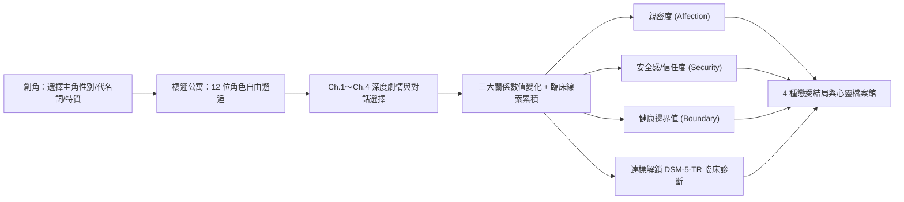

# 《愛的邊緣》(Edge of Love) — 遊戲規格設計書 (Game Specification)

> [!IMPORTANT]
> 本規格書依據專案內的 [DSM5TR PD.pdf](./DSM5TR%20PD.pdf) 臨床診斷準則與鑑別診斷特徵設計，將 12 種人格障礙轉化為具深度、去污名化且富《戀與製作人》浪漫唯美張力的戀愛養成體驗。

---

## 1. 遊戲世界觀與核心定位

- **遊戲名稱**：《愛的邊緣》(Edge of Love)
- **舞台設定**：「棲遲公寓（The Liminal House）」與周邊街區（包含大學研究室、獨立咖啡廳、夜間酒吧、藝術工作室、社區心理諮詢中心、天台花園）。主角作為新搬入棲遲公寓的房客兼社區共創計畫協調員，在與 12 位性格鮮明卻各自背負人際困境的角色相遇過程中，逐步走進他們的內心世界。
- **核心主題**：理解、邊界與連結。在親密關係中，「無底線的討好」往往會掉入**病態共依存（Codependency）**，「強行改變對方」則會觸發**防禦崩潰（Trigger / Breakdown）**；唯有理解對方行為背後的恐懼，並守住健康的自我邊界，才能抵達真正的親密（True End）。

---

## 2. 主角設定、全員戀愛模式與漸進式診斷解鎖機制

### 2.1 主角初始設定
玩家開局可自訂：
1. **主角姓名**
2. **生理性別與性別認同**：
   - 生理女性（Cis / Trans 皆可自訂代名詞）
   - 生理男性（Cis / Trans 皆可自訂代名詞）
   - 非二元性別／雙性人（Non-binary / Intersex）
3. **人際特質傾向（初始加成）**：共情敏銳度、情緒穩定度、邊界堅定度。

### 2.2 固定全員戀愛模式（Full Romance Mode）
- 12 位角色各自擁有多元的生理性別、性別認同與性取向背景設定（異性戀、男同性戀、女同性戀、雙性戀、泛性戀、無性戀半浪漫傾向等）。
- **固定全員戀愛線**：不設分流開關，不論玩家選擇何種主角性別，與全部 12 位角色皆固定進入完整的**「浪漫戀人線（Full Romance Route）」**，對話文本會自動適配主角代名詞。

### 2.3 漸進式 DSM-5-TR 臨床診斷解鎖機制
- **初始隱藏診斷**：遊戲開始時，所有角色的「人格障礙診斷名稱」、「ICD-10-CM 代碼」與「Cluster 分類」皆處於**未解鎖隱藏狀態（`🔒 尚待臨床觀察（線索 X / N）`）**，玩家僅能看到角色的外在性格標籤與日常表現。
- **隨劇情推進收集行為線索**：在 Ch.1～Ch.4 的互動過程中，當角色展現出符合 DSM-5-TR 診斷準則的典型防禦行為或人際模式時，系統會記錄一則「行為觀察線索」。
- **達標正式揭曉診斷**：唯有當該角色累積的行為觀察線索達到 **DSM-5-TR 臨床診斷閾值（Diagnostic Threshold）** 時，系統才會正式揭示其對應的人格障礙診斷名稱、核心臨床特徵與鑑別診斷分析。

---

## 3. 12 位可攻略角色設定一覽（依 DSM-5-TR 準則設計）

### 【Cluster A：奇特／古怪型（Odd / Eccentric）】

| 編號 | 角色／職業 | 對應 DSM-5-TR 診斷（達標後解鎖） | 生理性別 / 性別認同 | 性取向設定 | 核心性格與戀愛雷區（基於臨床特徵） | 立繪檔案 |
| :--- | :--- | :--- | :--- | :--- | :--- | :--- |
| **01** | **沈墨 (Shen Mo)** 數位取證專家／資安駭客 | **妄想型人格障礙症** Paranoid PD (F60.0) | 生理男 | 雙性戀 (Bisexual) | **特徵**：極度猜疑、隨身錄音、將普通讚美解讀為諷刺或刺探、對背叛零容忍。 **攻略關鍵**：絕不能說謊或製造「驚喜」；需用高度透明、前後一致的行動瓦解他的防衛。 | [`shen_mo.png`](./assets/characters/shen_mo.png) |
| **02** | **林見微 (Lin Jianwei)** 天文台觀測員／鐘錶修復師 | **孤僻型人格障礙症** Schizoid PD (F60.1) | 生理女 | 無性戀／半浪漫傾向 (Asexual / Demiromantic) | **特徵**：情感淡漠、喜愛抽象與機械事物、對社交與熱鬧無感、不在乎外界毀譽。 **攻略關鍵**：不強迫她表達熱情或參加聚會，學會「在同一個空間安靜獨處」的陪伴。 | [`lin_jianwei.png`](./assets/characters/lin_jianwei.png) |
| **03** | **星野 琉璃 (Ruri)** 神祕占星插畫家／古著店主 | **思覺失調型人格障礙症** Schizotypal PD (F21) | 生理女（非二元流動認同） | 泛性戀 (Pansexual) | **特徵**：關係意念（覺得路牌或鳥鳴在對自己暗示）、魔幻思考、言談充滿詩意隱喻、熟識後仍會社交焦慮。 **攻略關鍵**：理解其奇特儀式背後的不安，成為連結她與現實世界的溫柔翻譯者。 | [`ruri.png`](./assets/characters/ruri.png) |

---

### 【Cluster B：戲劇化／情緒化／不穩定型（Dramatic / Emotional / Erratic）】

| 編號 | 角色／職業 | 對應 DSM-5-TR 診斷（達標後解鎖） | 生理性別 / 性別認同 | 性取向設定 | 核心性格與戀愛雷區（基於臨床特徵） | 立繪檔案 |
| :--- | :--- | :--- | :--- | :--- | :--- | :--- |
| **04** | **韓梟 (Han Xiao)** 危機談判專家／地下調酒師 | **反社會型人格障礙症** Antisocial PD (F60.2) | 生理男 | 泛性戀 (Pansexual) | **特徵**：表面極具魅力、能言善道，實則無視規則、厭惡無聊、擅長操弄人心、缺乏罪惡感。 **攻略關鍵**：一味順從會淪為被利用的獵物（Bad End）；必須看穿其把戲並立下強硬底線，贏得他真正的對等尊重。 | [`han_xiao.png`](./assets/characters/han_xiao.png) |
| **05** | **蘇緋 (Su Fei)** 交響樂團大提琴首席 | **邊緣型人格障礙症** Borderline PD (F60.3) | 生理女 | 雙性戀 (Bisexual) | **特徵**：極度恐懼被拋棄（回訊慢五分鐘就會恐慌）、在「你是我的神」與「你最殘忍」間極端擺盪、慢性空虛。 **攻略關鍵**：不能隨她的情緒起舞或冷暴力，需展現「接納情緒但堅守界線」的穩定感。 | [`su_fei.png`](./assets/characters/su_fei.png) |
| **06** | **夏樂 (Xia Le)** 人氣時尚偶像／舞台劇演員 | **做作型（戲劇化）人格障礙症** Histrionic PD (F60.4) | 生理男 | 男同性戀／泛浪漫光譜 | **特徵**：無法忍受自己不是全場焦點、言談誇張缺乏細節、習慣用魅力吸引所有人，卻害怕卸妝後的真實親密。 **攻略關鍵**：在聚光燈熄滅後，肯定他不表演時的平凡模樣。 | [`xia_le.png`](./assets/characters/xia_le.png) |
| **07** | **顧傾城 (Gu Qingcheng)** 建築事務所創辦人 | **自戀型人格障礙症** Narcissistic PD (F60.81) | 生理女 | 女同性戀／泛浪漫光譜 | **特徵**：自視非凡、只與「頂尖的人」來往、理所當然的特權感、具認知同理卻無情感同理，傲慢面具下藏著對缺陷的羞恥。 **攻略關鍵**：不盲目吹捧，也不當眾刺傷其自尊，在她遭遇挫折時接住她的脆弱。 | [`gu_qingcheng.png`](./assets/characters/gu_qingcheng.png) |

---

### 【Cluster C：焦慮／恐懼型（Anxious / Fearful）】

| 編號 | 角色／職業 | 對應 DSM-5-TR 診斷（達標後解鎖） | 生理性別 / 性別認同 | 性取向設定 | 核心性格與戀愛雷區（基於臨床特徵） | 立繪檔案 |
| :--- | :--- | :--- | :--- | :--- | :--- | :--- |
| **08** | **溫言 (Wen Yan)** 古籍修復師／獨立譯者 | **畏避型人格障礙症** Avoidant PD (F60.6) | 生理男 | 異性戀／雙性浪漫光譜 | **特徵**：內心極度渴望被愛，卻因深信自己「無趣、不討喜」而逃避社交；對微小的皺眉或嘆氣極度敏感。 **攻略關鍵**：提供可預期、無批評的安全感，切忌強拉他去大型派對「練膽」。 | [`wen_yan.png`](./assets/characters/wen_yan.png) |
| **09** | **白小鹿 (Bai Xiaolu)** 溫室甜點學徒／花店助手 | **依賴型人格障礙症** Dependent PD (F60.7) | 生理女 | 雙性戀 (Bisexual) | **特徵**：連日常小事都要依賴他人決定；害怕失去依靠而不敢說「不」，甚至甘願受委屈；害怕變獨立後會被拋棄。 **攻略關鍵**：最大的陷阱是「替她做好所有決定」（會導致病態依賴結局）；必須引導她自己做選擇並給予支持。 | [`bai_xiaolu.png`](./assets/characters/bai_xiaolu.png) |
| **10** | **紀嚴 (Ji Yan)** 臨床研究審查官／古典鋼琴家 | **強迫型人格障礙症** Obsessive-Compulsive PD (F60.5) | 生理男 | 異性戀／泛浪漫光譜 | **特徵**：清單與時間表控、完美主義、道德標準嚴苛、不願授權他人、情感表達極度拘謹。 **攻略關鍵**：不要強行打亂他的秩序，而是在計畫意外失控時陪他練習「容許不完美」。 | [`ji_yan.png`](./assets/characters/ji_yan.png) |

---

### 【Other Personality Disorders：其他特定／身體病況類別】

| 編號 | 角色／職業 | 對應 DSM-5-TR 診斷（達標後解鎖） | 生理性別 / 性別認同 | 性取向設定 | 核心性格與戀愛雷區（基於臨床特徵） | 立繪檔案 |
| :--- | :--- | :--- | :--- | :--- | :--- | :--- |
| **11** | **陸晴嵐 (Lu Qinglan)** 前極限攝影師／現職陶藝家 | **另一身體病況引起之人格改變** Personality Change Due to Another Medical Condition (F07.0) | 生理女 | 泛性戀 (Pansexual) | **特徵**：意外額葉受損後康復，從原本嚴謹冷靜變得直率衝動、情緒起伏快（Labile / Disinhibited type），被舊識感嘆「不再是以前的她」。 **攻略關鍵**：不拿過去的完美形象要求她，接納並愛上「重生後」此刻的她。 | [`lu_qinglan.png`](./assets/characters/lu_qinglan.png) |
| **12** | **游子謙 (You Ziqian)** 獨立策展人／咖啡廳店長 | **其他特定之人格障礙症（被動攻擊／混合特徵）** Other Specified PD - Passive-Aggressive / Mixed (F60.89) | 生理男 | 男同性戀／雙性戀 | **特徵**：表面永遠溫和微笑說「好啊、沒問題、都聽你的」，轉頭卻故意拖延、忘記約定、用消極抵抗表達不滿。 **攻略關鍵**：不能只聽他表面的順從，也不能因他拖延而暴怒，需戳破溫和假象並鼓勵他直接表達真實情緒。 | [`you_ziqian.png`](./assets/characters/you_ziqian.png) |

---

## 4. 核心玩法與系統設計

### 4.1 三維度關係數值（決定結局走向）
1. **親密度 (Affection)**：角色對主角的浪漫吸引與依戀程度。
2. **安全感 (Security)**：角色在主角面前卸下防衛機制、感到不被評判的程度。
3. **健康邊界 (Boundary)**：雙方是否維持健康自主的人際界線（過低會變成「病態共依存／控制／剝削」，過高則會顯得疏離冷漠）。

### 4.2 四種結局型態
- **True End（邊緣之愛／健康共生）**：高親密 ＋ 高安全感 ＋ 健康邊界值。理解其人格特質，不強行「治癒」但找到健康的相愛之道。
- **Codependent End（沉淪／病態共依存結局）**：高親密 ＋ 低邊界值。主角無底線迎合角色的病態需求，兩人陷入窒息而甜蜜的泥淖。
- **Trigger / Bad End（防禦崩潰／決裂結局）**：觸發角色的核心防衛機制，導致關係徹底破裂。
- **Normal End（溫柔平行線結局）**：安全但未深入核心議題。

---

## 5. 視覺風格、角色 Prompt 庫與技術架構

### 5.1 《戀與製作人》浪漫唯美卡牌美學
- **UI 設計**（[`styles/main.css`](./styles/main.css)）：暮光玫瑰金、香檳流光細框、圓拱長條卡面（Arched Card Pillars）、SSR/SR 稀有度徽章與柔焦星塵花瓣光斑。
- **角色立繪與動態情緒光影**（[`js/ui/avatarRenderer.js`](./js/ui/avatarRenderer.js)）：12 位角色皆具備《戀與製作人》風格專屬立繪，並隨對話情緒（`guarded`、`smiling`、`vulnerable`、`agitated`、`intense`、`peaceful`）即時切換光暈與粒子特效。

### 5.2 角色外觀錨點與劇情動作 Prompt 生成系統
為支援後續根據劇情動態生成同一角色的不同動作與分鏡 CG，專案內建完整 Prompt 資料庫：
- **ES Module**：[`js/data/characterPrompts.js`](./js/data/characterPrompts.js)（提供 `buildCharacterActionPrompt(charId, emotion, chapterNum, customAction)` 函式）
- **JSON 結構檔**：[`prompts/character_prompts.json`](./prompts/character_prompts.json)
- **Markdown 完整手冊**：[`prompts/CHARACTER_PROMPTS.md`](./prompts/CHARACTER_PROMPTS.md)
- **遊戲內建「🎨 角色動作 Prompt 庫」工坊**：可於遊戲頂部導覽列或對話立繪下方直接切換章節與情緒、一鍵複製完整繪圖 Prompt。

### 5.3 瀏覽器自動持久化存檔系統
- 採用 `sessionStorage` 與 `localStorage` 雙重自動同步機制，每次對話選擇、數值變動與臨床線索解鎖皆即時自動儲存，下次打開瀏覽器可直接無縫接續進度，亦提供 3 個手動存檔槽位與 JSON 匯出／匯入功能。
